# CAD2IC 芯桥：多智能体 RTL 生成与跨基准评测

## 项目状态

- 阶段：实验冻结，进入展示材料收尾
- 完成日期：2026-11-10
- 项目目录：`/root/autodl-tmp`
- CAD 基线：`mac_api_cadtestbench`
- IC 主框架：`MAGE`
- IC 基准：VerilogEval V2、RTLLM V2
- 官方评测：CADTestBench、VerilogEval 官方 Makefile、RTLLM 官方 testbench

## 1. 摘要

本项目围绕两条链路展开。

第一条链路忠实运行现成 CAD 多智能体基准：

```text
自然语言 CAD 规格
-> MAC 多智能体生成
-> STEP 产物
-> CadQuery 桥接
-> CADTestBench 官方评分
-> 指标、日志、图与运行记录
```

第二条链路使用 MAGE 完成规格到 RTL 的复现与迁移：

```text
自然语言 RTL 规格
-> MAGE TB/RTL 生成
-> iverilog/vvp 执行
-> SimJudge 与 RTLEditor 修复
-> 官方 testbench 评分
-> 运行记录与跨基准汇总
```

RTL 实验先跑通 VerilogEval V2，再通过 benchmark adapter 迁移到 RTLLM V2。
智能体角色、提示词和协作拓扑保持原样，改动集中在 provider、benchmark loader、
runner、evaluator 和实验记录层。

最终形成 A/B/C/D 四组全量对照、固定任务三次重复、复杂任务子集分析和修复增益分析。
证据显示 MAGE 在 VerilogEval V2 的官方 testbench 可见条件下具有明确正向表现。
该优势在 RTLLM V2、官方 testbench 隐藏条件和固定重复子集中表现有限。

## 2. 项目目标

### 2.1 工程目标

1. 还原 CAD 项目的生成、执行、桥接、官方评分和可视化链路。
2. 在服务器上建立 CAD 生成环境与评测环境。
3. 使用固定 revision、固定数据和固定工具版本完成 CAD 单题及 200 题全量。
4. 固定 MAGE revision，实现 DeepSeek provider 接入。
5. 使用 VerilogEval V2 完成首套 RTL 官方基准复现。
6. 保持 MAGE 智能体结构，完成 RTLLM V2 基准迁移。
7. 建立统一 Task、Generator、Executor、Evaluator、RunRecord 实验契约。
8. 完成官方 testbench 可见性、单 Agent、多智能体、重复性与修复贡献分析。

### 2.2 展示目标

项目面向研究生保研与复试展示，重点体现：

- 开源项目阅读与复现能力；
- 环境、版本、API 和工具链集成能力；
- 官方 testbench 与官方评分器的使用能力；
- benchmark adapter 设计能力；
- 实验记录、失败分类与结果解释能力；
- 对结果边界的准确表达能力。

## 3. 复现对象与固定版本

| 对象 | 固定版本 |
|---|---|
| MAGE | `90c96366c518d32bd7b81703bdef3cc46eeaeaf9` |
| VerilogEval V2 | `c498220d0a52248f8e3fdffe279075215bde2da6` |
| RTLLM V2 | `41b26896e33b536940116a975626455eed3de65e` |
| Multi-Agent-CAD | `487f94b7064e935c1a9a2f9b426525d5c94cd857` |
| CADTestBench | `e29283cc61db7329039d95b429766a50bfd37f89` |
| CADTestBench 数据 | `2b9a4a972d142d2bc634d072e9d4485f171ced06` |

许可证：

- MAGE：MIT；
- RTLLM：MIT；
- Multi-Agent-CAD：项目内许可证；
- CADTestBench：项目内许可证。

## 4. 服务器环境

| 组件 | 版本 |
|---|---|
| 操作系统 | Ubuntu 22.04.3 LTS |
| 内核 | Linux 5.15.0-78-generic |
| CPU | Intel Xeon Platinum 8352V |
| 逻辑 CPU | 128 |
| 内存 | 1 TiB |
| Conda | 22.11.1 |
| `mac-gen` Python | 3.12.16 |
| `mac-eval` Python | 3.12.16 |
| `mage` Python | 3.11.18 |
| Icarus Verilog | 12.0 |
| vvp | 12.0 |
| Verilator | 5.054 |
| Pyverilog | 1.3.0 |

隔离关系：

```text
mac-gen  -> MAC 生成、build123d、API 客户端
mac-eval -> CadQuery、CADTestBench、绘图、Notebook
mage     -> MAGE、VerilogEval、RTLLM、iverilog、Verilator
```

API 配置：

- provider：`deepseek`
- model：`deepseek-flash`
- base URL：`https://api.deepseek.com`
- thinking：disabled
- Key 存储：权限 `600` 的服务器本地环境文件
- 全部正式运行目录：Key 出现次数为 0

## 5. 工程结构

```text
/root/autodl-tmp/
├── README.md
├── PROJECT_FINAL_REPORT.md
├── plan.md
├── plan2.md
├── plan3.md
├── mac_api_cadtestbench/
├── MAGE/
├── RTLLM/
├── integration/
└── runs/
```

核心集成代码：

| 文件 | 职责 |
|---|---|
| `integration/mage_benchmark_runner.py` | VerilogEval MAGE runner |
| `integration/rtllm_runner.py` | RTLLM MAGE runner |
| `integration/single_agent_runner.py` | 单 Agent hidden/assisted controller |
| `integration/verilog_eval_official_eval.py` | VerilogEval 官方评测 adapter |
| `integration/rtllm_official_eval.py` | RTLLM 官方评测 adapter |
| `integration/budget_guard.py` | 调用、token、时间预算 |
| `integration/plan3_repeat_orchestrator.py` | 2×4×3 重复实验编排 |
| `integration/plan3_analyze.py` | 2×2、重复、复杂子集分析 |
| `integration/plan3_repair_analysis.py` | round-1 与最终 RTL 修复分析 |

## 6. CAD 基线实验

### 6.1 数据与验证

- detailed 样本：200
- 固定快照文件：112
- SHA256 校验：全部通过
- 冒烟样本：`00985494`
- 官方测试资源：本地 Parquet 数据
- 评测入口：CADTestBench 官方 `CADTestMetric`

### 6.2 冒烟结果

| 项目 | 结果 |
|---|---:|
| 样本 | 1 |
| 生成状态 | completed |
| 最终 STEP | 非空 |
| CadQuery 桥接 | 成功 |
| 官方测试 | 10/14 |
| PR | 0.0% |
| RS | 55.56% |
| 可视化 | PNG 与交互式 HTML |

### 6.3 detailed 全量

| 指标 | 本次运行 |
|---|---:|
| 样本数 | 200 |
| PR | 22.0% |
| RS | 48.0819% |
| 无效样本 | 34.0% |
| 官方测试通过数 | 1512/3037 |
| 全部官方测试通过样本 | 44 |
| 非空 STEP | 133 |
| 生成状态 completed | 98 |
| 生成状态 completed_internal_failure | 102 |
| 生成、桥接包装器错误 | 0 |
| API 预算耗尽 | 0 |

归档结果对照：

| 指标 | 本次 | 归档 |
|---|---:|---:|
| PR | 22.0% | 26.5% |
| RS | 48.0819% | 51.0282% |
| 无效样本 | 34.0% | 33.5% |

两次运行生成状态分布相同，逐题状态存在互换，结果差异可由远程模型输出波动解释。

### 6.4 CAD 失败分类

- 官方缺少可执行产物：68
- 官方模型代码加载失败：67
- 官方执行异常：1
- 官方测试断言失败：88
- 内部 QA dimension：89
- 内部 QA topology：15
- 工具链包装器超时或崩溃：0

所有失败样本保留在官方分母。

## 7. VerilogEval V2 复现

### 7.1 数据验证

- spec-to-rtl 题目：156
- prompt：156
- 官方 testbench：156
- 参考 RTL：156
- 官方 Makefile 评测：156/156
- 参考 RTL 官方测试：通过
- 故意错误 RTL 官方测试：失败
- loader 字段保持官方原文

### 7.2 主结果

| 组 | 官方 testbench | 通过 | pass@1 |
|---|---|---:|---:|
| A：MAGE-assisted | 可见 | 141/156 | 90.3846% |
| B：MAGE-hidden | 隐藏 | 115/156 | 73.7179% |
| C：Single-hidden | 隐藏 | 121/156 | 77.5641% |
| D：Single-assisted | 可见 | 125/156 | 80.1282% |

### 7.3 关键效应

| 比较 | 差值 | bootstrap 95% CI | exact McNemar |
|---|---:|---:|---:|
| A-D，MAGE-assisted 对 Single-assisted | MAGE 高 10.26 pp | `[+4.49, +16.03]` pp | `p=0.00154` |
| B-C，Single-hidden 对 MAGE-hidden | 单 Agent 高 3.85 pp | `[-3.21, +10.90]` pp | `p=0.3616` |
| A-B，testbench 对 MAGE 的效应 | 高 16.67 pp | `[+9.62, +23.72]` pp | `p=0.000006` |
| D-C，testbench 对单 Agent 的效应 | 高 2.56 pp | `[-2.56, +7.69]` pp | `p=0.4807` |

A/D discordant count：

- A 通过、D 失败：4
- D 通过、A 失败：20

结果说明 MAGE 在 VerilogEval 官方 testbench 可见条件下具有明确正向信号。

### 7.4 官方结果码

| 组 | `.` | `R` | `m` | `T` | `C` | `r` |
|---|---:|---:|---:|---:|---:|---:|
| A | 141 | 5 | 6 | 3 | 1 | 0 |
| B | 115 | 29 | 8 | 3 | 1 | 0 |
| C | 121 | 30 | 1 | 3 | 1 | 0 |
| D | 125 | 26 | 0 | 3 | 1 | 1 |

结果码含义：

- `.`：通过
- `R`：raw mismatch
- `m`：模块或产物缺失
- `T`：官方 analyzer timeout 标签
- `C`：编译错误
- `r`：运行时条件检查

## 8. RTLLM V2 迁移

### 8.1 数据与适配

- 设计数：50
- 官方 description：50
- 官方 testbench：50
- 官方参考 RTL：50
- 类别：Arithmetic、Memory、Control、Miscellaneous
- 参考 RTL 官方测试：50/50 通过

数据适配点：

- `freq_divbyeven` 描述模块名与 testbench 模块名存在拼写差异；
- `fixed_point_substractor` 目录拼写与模块名存在差异；
- adapter 优先使用官方 testbench 实例化名称；
- 参考 RTL 首个主模块名机械替换为官方期望模块名；
- RTL 内部逻辑保持原样。

### 8.2 仿真器策略

| 仿真器 | 题目数 | 说明 |
|---|---:|---|
| Icarus Verilog 12.0 | 46 | 主路径 |
| Verilator 5.054 | 4 | Icarus 兼容性 fallback |

Verilator fallback：

- `asyn_fifo`：官方 testbench 使用 `break`
- `ring_counter`：官方 testbench 使用数组整体赋值
- `radix2_div`：Icarus 时序语义差异
- `clkgenerator`：Icarus 时序语义差异

两套仿真器均直接执行 RTLLM 原始官方 testbench，通过文本来自官方
`Your Design Passed`。

### 8.3 主结果

| 组 | 官方 testbench | 通过 | pass@1 |
|---|---|---:|---:|
| A：MAGE-assisted | 可见 | 42/50 | 84.0% |
| B：MAGE-hidden | 隐藏 | 36/50 | 72.0% |
| C：Single-hidden | 隐藏 | 37/50 | 74.0% |
| D：Single-assisted | 可见 | 41/50 | 82.0% |

### 8.4 关键效应

| 比较 | 差值 | bootstrap 95% CI |
|---|---:|---:|
| A-D，MAGE-assisted 对 Single-assisted | MAGE 高 2.0 pp | `[-14, +10]` pp |
| B-C，Single-hidden 对 MAGE-hidden | 单 Agent 高 2.0 pp | `[0, +6]` pp |
| A-B，testbench 对 MAGE 的效应 | 高 12.0 pp | `[+2, +24]` pp |
| D-C，testbench 对单 Agent 的效应 | 高 8.0 pp | `[0, +18]` pp |

RTLLM 中 MAGE-assisted 与 Single-assisted 仅差 1 题，证据强度有限。

### 8.5 类别结果

| 类别 | MAGE-assisted |
|---|---:|
| Arithmetic | 18/19，94.74% |
| Control | 6/6，100% |
| Memory | 3/5，60% |
| Miscellaneous | 15/20，75% |

### 8.6 失败分类

| 组 | 通过 | 产物缺失 | 编译错误 | 功能 mismatch | 运行错误 | 仿真超时 |
|---|---:|---:|---:|---:|---:|---:|
| A | 42 | 0 | 0 | 4 | 3 | 1 |
| B | 36 | 2 | 4 | 4 | 3 | 1 |
| C | 37 | 0 | 5 | 4 | 3 | 1 |
| D | 41 | 0 | 3 | 3 | 2 | 1 |

## 9. 固定 10 题 × 3 次重复

任务列表在 API 运行前生成，选择规则基于固定 SHA256 与类别分层。

### 9.1 VerilogEval

| 组 | 三次通过数 | 平均通过数 | 平均 pass@1 | 标准差 |
|---|---|---:|---:|---:|
| A | 9, 9, 7 | 8.33/10 | 83.33% | 0.94 |
| B | 7, 8, 6 | 7.00/10 | 70.0% | 0.82 |
| C | 8, 8, 7 | 7.67/10 | 76.67% | 0.47 |
| D | 6, 6, 6 | 6.00/10 | 60.0% | 0.00 |

### 9.2 RTLLM

| 组 | 三次通过数 | 平均通过数 | 平均 pass@1 | 标准差 |
|---|---|---:|---:|---:|
| A | 9, 8, 8 | 8.33/10 | 83.33% | 0.47 |
| B | 5, 7, 7 | 6.33/10 | 63.33% | 0.94 |
| C | 7, 7, 7 | 7.00/10 | 70.0% | 0.00 |
| D | 10, 8, 8 | 8.67/10 | 86.67% | 0.94 |

重复实验体现了远程模型波动。VerilogEval 的 assisted 组方向与全量一致，
RTLLM 的 assisted 组方向偏向单 Agent。

## 10. 复杂任务子集

复杂子集由规格 `cl100k_base` token 数前 50% 固定生成，规则独立于模型结果。

| 基准 | 题数 | A | B | C | D |
|---|---:|---:|---:|---:|---:|
| VerilogEval | 78 | 84.62% | 60.26% | 60.26% | 69.23% |
| RTLLM | 25 | 76.0% | 68.0% | 68.0% | 80.0% |

VerilogEval 复杂子集中，MAGE-assisted 比 Single-assisted 高 15.38 个百分点。
RTLLM 复杂子集中，Single-assisted 比 MAGE-assisted 高 4 个百分点。

## 11. 修复贡献分析

对 C/D 的 round-1 RTL 和最终 RTL 分别使用官方 evaluator。

| 运行 | round-1 通过 | 最终通过 | 恢复 | 回归 |
|---|---:|---:|---:|---:|
| C × VerilogEval full | 109/156 | 121/156 | 13 | 1 |
| D × VerilogEval full | 120/156 | 125/156 | 5 | 0 |
| C × RTLLM full | 34/50 | 37/50 | 3 | 0 |
| D × RTLLM full | 35/50 | 41/50 | 7 | 1 |

重复 run 合计：

| 运行 | round-1 通过 | 最终通过 |
|---|---:|---:|
| C × VerilogEval | 19/30 | 23/30 |
| D × VerilogEval | 16/30 | 18/30 |
| C × RTLLM | 19/30 | 21/30 |
| D × RTLLM | 18/30 | 26/30 |

修复流程能把官方失败转换为官方通过，同时存在少量回归。

MAGE A/B 的 round-1 RTL 无法从现有日志稳定恢复，记录标记为
`not_recoverable`，项目未进行猜测。

## 12. 资源使用

### 12.1 三次重复生成资源

| 基准/组 | API calls | 总 token | 累计耗时 |
|---|---:|---:|---:|
| VerilogEval A | 275 | 1,918,574 | 31.7 分钟 |
| VerilogEval B | 163 | 1,041,385 | 25.0 分钟 |
| VerilogEval C | 51 | 196,892 | 7.4 分钟 |
| VerilogEval D | 51 | 315,703 | 6.9 分钟 |
| RTLLM A | 156 | 805,458 | 27.9 分钟 |
| RTLLM B | 170 | 1,191,068 | 18.6 分钟 |
| RTLLM C | 59 | 436,975 | 7.0 分钟 |
| RTLLM D | 66 | 542,843 | 9.0 分钟 |

MAGE 使用较多调用与 token。单 Agent 具备更低资源成本。

### 12.2 全量运行时间

| 运行 | 时间 |
|---|---:|
| CAD detailed 生成 | 约 2 小时 13 分 |
| CAD 官方评测 | 约 20 分 |
| VerilogEval A | 约 2 小时 10 分 |
| RTLLM A | 约 1 小时 3 分 |
| Plan 2 与 Plan 3 全量及重复 | 分阶段独立记录 |

## 13. 修改边界

### 13.1 MAGE provider 层

- `gen_config.py`：新增 DeepSeek provider、base URL、thinking disabled；
- `token_counter.py`：未知 OpenAI-compatible 模型回退 `cl100k_base`。

### 13.2 集成层

- MAGE benchmark runners；
- Single Agent controller；
- VerilogEval 官方 evaluator adapter；
- RTLLM loader 与官方 evaluator adapter；
- 预算守卫；
- Plan 3 重复编排、统计与修复分析；
- 自动测试。

### 13.3 上游保持

- MAGE Agent 角色与协作拓扑保持原样；
- MAGE 提示词保持原样；
- VerilogEval 官方 testbench 保持原样；
- RTLLM 官方 testbench 保持原样；
- CAD 第三方源码保持原样；
- CAD 评测代码保持原样。

## 14. 可复现命令

### 14.1 测试

```bash
cd /root/autodl-tmp/MAGE
conda run -n mage pytest -q tests/test_mage_integration.py

cd /root/autodl-tmp/integration
conda run -n mage pytest -q test_single_agent.py test_rtllm.py
```

结果：

- MAGE integration：4 passed
- Plan 2/3 integration：9 passed

### 14.2 VerilogEval 单题

```bash
source /root/.config/mac_api_cadtestbench/env
python /root/autodl-tmp/integration/mage_benchmark_runner.py \
  --run-dir /root/autodl-tmp/runs/example_verilog_eval \
  --filter '^(Prob011_norgate)$' \
  --temperature 0.85 --top-p 0.95 --max-tokens 8192 --use-golden-tb
```

### 14.3 RTLLM 单题

```bash
source /root/.config/mac_api_cadtestbench/env
python /root/autodl-tmp/integration/rtllm_runner.py \
  --run-dir /root/autodl-tmp/runs/example_rtllm \
  --filter '^(adder_8bit)$' \
  --temperature 0.85 --top-p 0.95 --max-tokens 8192 --use-golden-tb
```

### 14.4 Single-assisted

```bash
source /root/.config/mac_api_cadtestbench/env
python /root/autodl-tmp/integration/single_agent_runner.py \
  --benchmark verilog_eval_v2 \
  --run-dir /root/autodl-tmp/runs/example_single_assisted \
  --filter '^(Prob011_norgate)$' \
  --temperature 0.85 --top-p 0.95 --max-tokens 8192 \
  --max-rounds 8 --use-official-tb
```

### 14.5 官方复算

```bash
python /root/autodl-tmp/integration/verilog_eval_official_eval.py \
  --run-dir <run_dir> --output-dir <run_dir>/official_eval

python /root/autodl-tmp/integration/rtllm_official_eval.py \
  --run-dir <run_dir> --output-dir <run_dir>/official_eval
```

## 15. 失败与中断记录

- CAD API 调用失败：0
- CAD 官方包装器错误：0
- RTLLM 官方参考 RTL 测试：50/50 通过
- DeepSeek 402 余额耗尽：C × VerilogEval 第 54 题后出现，充值后显式 resume
- DeepSeek HTTP 500、API timeout：出现在部分重复 run，均保留原始记录
- SDK 自动重试：正式结果关闭
- 首个 B × RTLLM partial run：出现一次 SDK 自动重试，已作废
- 正式 B × RTLLM run：自动重试关闭后完成
- Plan 3 空失败启动目录：单独隔离，未纳入统计
- 正式 Plan 3 repeat：24/24 个 run 均为 10/10
- 修复分析：16/16 组完成

## 16. 结论与适用边界

### 16.1 可以支持的结论

1. CAD、VerilogEval、RTLLM 三条官方评测链路已经跑通。
2. MAGE 的 provider 接入与两套 RTL benchmark adapter 可运行。
3. VerilogEval-assisted 全量中，MAGE 多智能体比单 Agent 高 10.26 个百分点。
4. MAGE 在 VerilogEval 复杂任务子集中同样呈现正向点估计。
5. 修复循环能把部分 round-1 官方失败转换为最终官方通过。
6. 官方 testbench 可见性对两组模型的成绩具有显著关联。

### 16.2 适用条件

MAGE 的正向证据集中于：

- VerilogEval V2；
- 官方 testbench 可见；
- DeepSeek `deepseek-flash`；
- temperature 0.85、top_p 0.95；
- 当前 MAGE 固定 revision；
- 当前生成预算与单次全量设置。

### 16.3 暂未支持的结论

1. 跨 RTLLM 的稳定多智能体优势；
2. 官方 testbench 隐藏条件下的多智能体优势；
3. 跨全部任务的普遍优势；
4. 零样本独立生成能力；
5. 远程模型任意重复运行下的固定数值。

### 16.4 最终对外表述

建议使用：

> 本项目先忠实复现 CAD 多智能体基准，再基于 MAGE 完成 VerilogEval V2 与
> RTLLM V2 的规格到 RTL 多智能体复现和跨基准迁移。实验使用官方 testbench、
> 固定版本、统一预算和完整运行记录。在 VerilogEval 的 testbench-assisted 条件下，
> MAGE 相对单 Agent 呈现明确正向效果；跨基准与 testbench-hidden 结果表明，
> 该优势具有条件性。项目贡献集中在工程复现、官方评测、adapter 设计和实验分析。

## 17. 可视化成果

本阶段只处理冻结结果的可视化表达，模型、题目、预算与官方评分保持原样。完整入口为
[docs/visualizations/index.html](docs/visualizations/index.html)，图表清单与数据
来源为 [docs/figures/manifest.json](docs/figures/manifest.json)。

### 17.1 生成原则

可视化管线遵循四条规则：

1. 官方 evaluator 结果优先，图表保留全部题目的原始分母。
2. A/B/C/D 使用固定颜色，全部 RTL 图共享同一套图例。
3. 图表标签采用英文，正文图注采用中文，便于文档、PPT 与网页复用。
4. 每张图记录源文件、样本数、生成时间与 SHA256，结果可追溯。

绘图入口为 `integration/plan4_visualize.py`。脚本从
`runs/plan3_results_20261110.json`、`runs/plan3_repair_analysis_20261110/summary.json`、
CAD `metrics.csv`、CAD `evaluations.json` 与八个正式 RTL evaluator 结果读取数据。

### 17.2 结构与迁移图

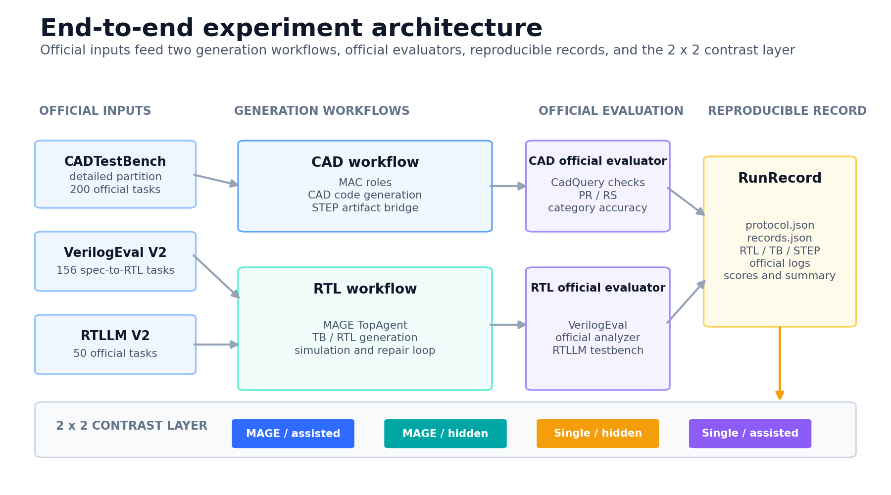

总体架构图按官方输入、生成工作流、官方评测、RunRecord 与 2×2 对照层组织。CAD 与
RTL 两条链路在记录层汇聚，展示工程抽象与实验组织方式。

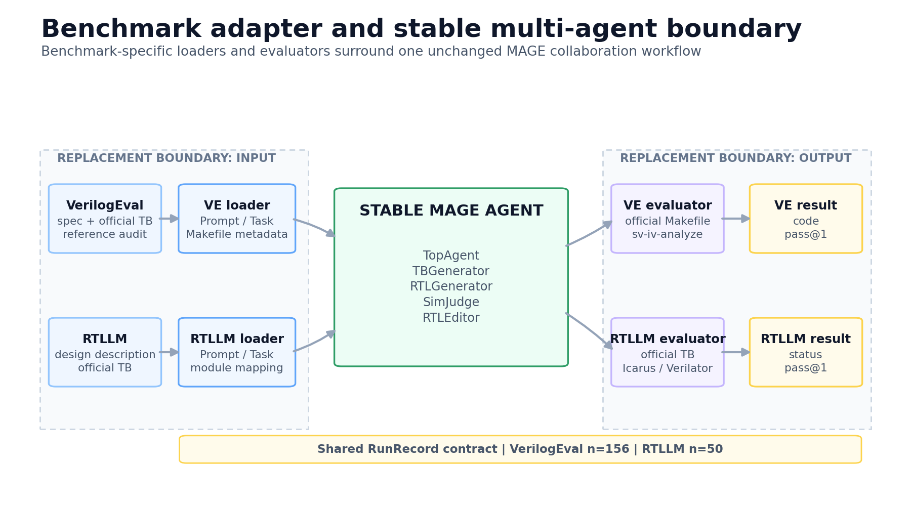

Adapter 图给出两个替换边界：输入侧替换官方 loader 与模块名映射，输出侧替换官方
evaluator。MAGE 的 `TopAgent`、`TBGenerator`、`RTLGenerator`、`SimJudge` 与
`RTLEditor` 协作关系保持原样。

结构图同时提供 PNG 与 SVG：

- `docs/figures/project_architecture.png`
- `docs/figures/project_architecture.svg`
- `docs/figures/benchmark_adapter.png`
- `docs/figures/benchmark_adapter.svg`

### 17.3 RTL 主结果图

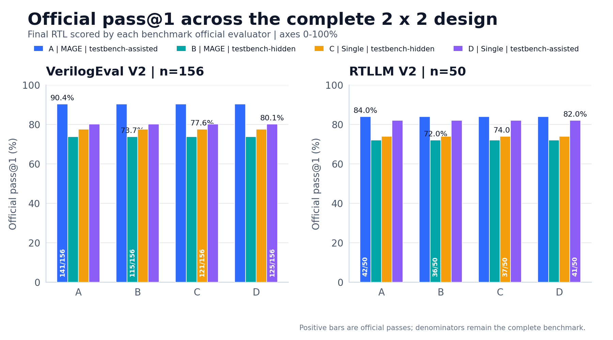

全量图使用官方 pass@1。柱内数字为通过数与分母，柱顶数字为百分比，两个 panel 的
纵轴固定为 0–100。四组结果为：

| Arm | 设计 | VerilogEval V2 | RTLLM V2 |
|---|---|---:|---:|
| A | MAGE-assisted | 141/156，90.4% | 42/50，84.0% |
| B | MAGE-hidden | 115/156，73.7% | 36/50，72.0% |
| C | Single-hidden | 121/156，77.6% | 37/50，74.0% |
| D | Single-assisted | 125/156，80.1% | 41/50，82.0% |

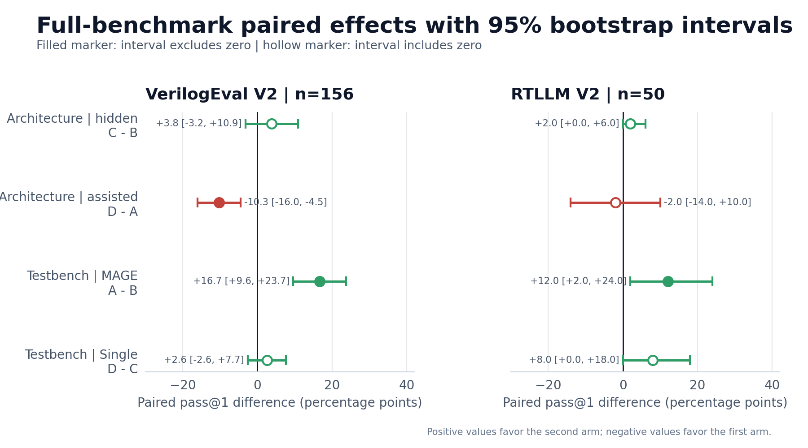

森林图将四类配对效应放在同一尺度：

- architecture-hidden：C−B；
- architecture-assisted：D−A；
- testbench effect for MAGE：A−B；
- testbench effect for Single：D−C。

零线对应两组结果相同。正值偏向 second arm，负值偏向 first arm。实心点表示区间离开
零线，空心点表示区间包含零线。VerilogEval-assisted 的 A−B 效应为
+16.67 个百分点，区间 `[+9.62,+23.72]`。

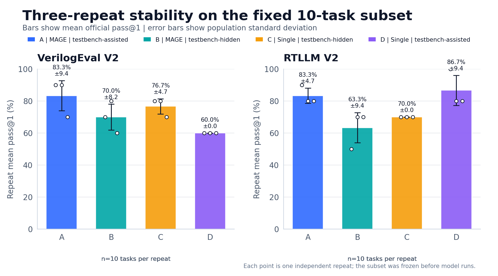

重复图展示固定 10 题的三次运行均值、总体标准差与单次结果点。VerilogEval 的 A/D
均值为 8.33/6.00，RTLLM 的 A/D 均值为 8.33/8.67。该图用于呈现远程模型波动，
结论范围限于预设 10 题。

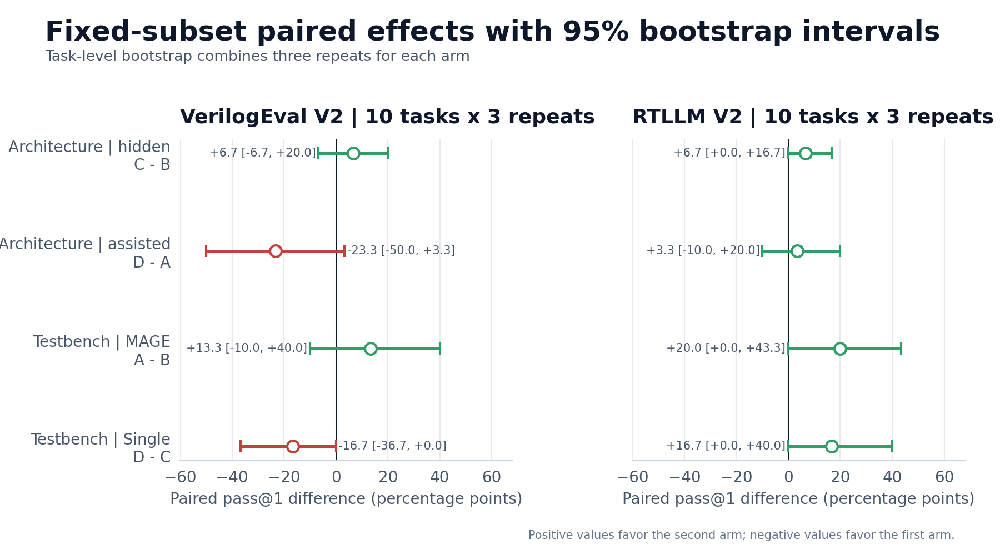

重复森林图按题目聚合三次运行，再计算 task-level bootstrap 区间。该分析作为全量
结果的稳定性补充，样本规模保持 10 题。

### 17.4 诊断图

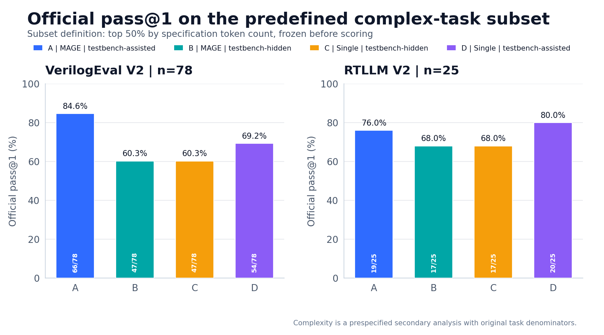

复杂任务集合在评分前按规格 token 数冻结。VerilogEval 子集包含 78 题，RTLLM 子集
包含 25 题，四组使用统一任务集合。

| Benchmark | A | B | C | D |
|---|---:|---:|---:|---:|
| VerilogEval | 66/78，84.6% | 47/78，60.3% | 47/78，60.3% | 54/78，69.2% |
| RTLLM | 19/25，76.0% | 17/25，68.0% | 17/25，68.0% | 20/25，80.0% |

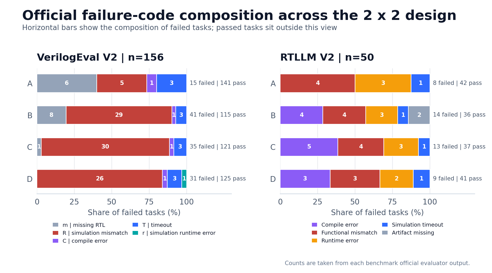

失败图读取八个正式 evaluator 结果文件。VerilogEval 使用 `m`、`R`、`C`、`T`、`r`
官方 code，RTLLM 使用 `compile_error`、`functional_mismatch`、`runtime_error`、
`simulation_timeout` 与 `artifact_missing` 状态。柱末同时保留失败数和通过数。

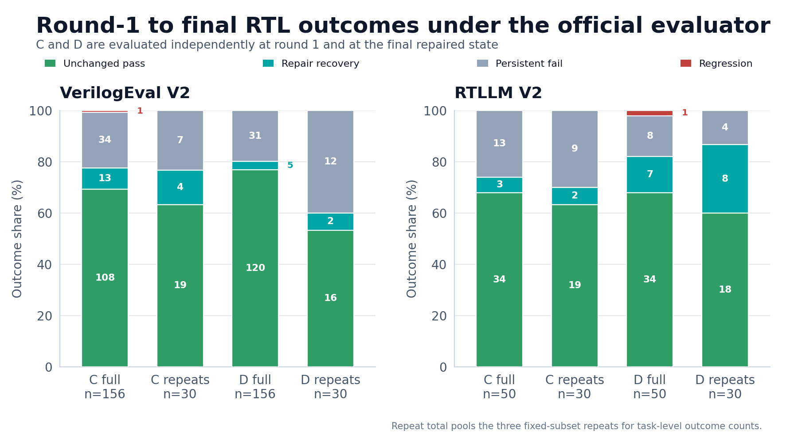

修复图只使用官方 evaluator。round-1 RTL 与最终 RTL 分别评分，结果拆分为：

- unchanged pass；
- repair recovery；
- persistent fail；
- regression。

全量与三次重复合计同时展示。VerilogEval 的 C 组出现 13 个修复恢复与 1 个回归；
RTLLM 的 D 组出现 7 个修复恢复与 1 个回归。

### 17.5 CAD 可视化

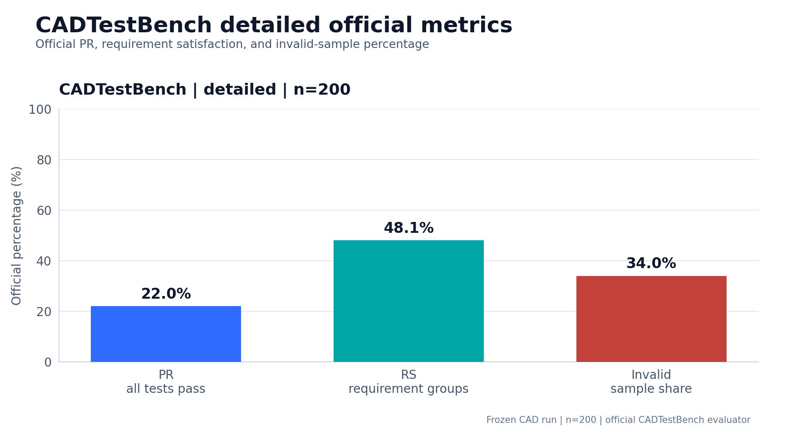

CAD 正式 run 的 detailed 分区包含 200 题。PR 为 22.0%，RS 为 48.0819%，无效样本
比例为 34.0%。

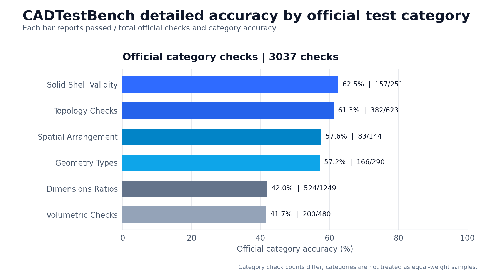

类别图按官方六类检查展示 accuracy 与 passed / total。3037 项检查的类别分母保持
原始值，类别结果按检查项统计。

图册同时索引正式 run 的既有资产：

- official_metrics.png；
- category_accuracy.png；
- generated_stl_gallery.png；
- sample_category_01.png 至 sample_category_06.png；
- rotatable_cad.html。

### 17.6 图册与验证

HTML 图册提供响应式卡片布局、PNG 入口、SVG 入口、源数据链接与交互模型入口。全部
图表使用 1800×1000 画布、200 dpi PNG 与可编辑文字 SVG。

重新生成命令：

```bash
/root/miniconda3/envs/mac-eval/bin/python integration/plan4_visualize.py
```

自动验证覆盖：

- 11 组图表与结构图同时生成 PNG 与 SVG；
- PNG 可打开，尺寸为 1800×1000；
- SVG 可解析，文本节点保留；
- HTML 本地链接全部存在；
- manifest 的源数据、输出文件与 SHA256 一致；
- 全量图、森林图、失败图、修复图与 CAD 图数值可追溯到正式结果；
- 活跃交付 Markdown 的用词检查保持通过；
- 工作区 API Key 泄漏扫描保持为 0。

### 17.7 两轮视觉优化

第一轮聚焦信息架构。图册删除重复森林图卡片，修复图合并到独立审计区，诊断区由
三列调整为双列。CAD 原始指标图与六张热图折叠为审计档案，主区保留新重绘图、STL
总览与交互模型。CAD 指标采用警示色表达无效样本比例，类别图采用蓝色灰阶体系，
与 A/B/C/D 组别配色分离。

第二轮聚焦展示层。首屏增加深色核心证据卡，RTL 区增加答辩版四组官方结果表，
六个章节加入统一线性图标。效应区改用完整图卡，补充标题、PNG、SVG 与源数据入口。
图册加入打印样式、移动端横向表格滚动与锚点留白，并固定单一修复入口、单一全量
效应入口与单一重复效应入口。

## 18. 最终材料索引

- `README.md`
- `plan.md`
- `plan2.md`
- `plan3.md`
- `docs/architecture.md`
- `docs/benchmark_adapter.md`
- `docs/results_and_failures.md`
- `docs/modification_manifest.md`
- `docs/presentation_3min.md`
- `docs/visualizations/index.html`
- `docs/figures/manifest.json`
- `integration/plan4_visualize.py`
- `integration/test_plan4_visuals.py`
- `plan4.md`
- `runs/cad_detailed_full_20261109.md`
- `runs/mage_verilogeval_full_20261109/README.md`
- `runs/rtllm_full_20261109/README.md`
- `runs/plan2_results_20261110.md`
- `runs/plan3_results_20261110.md`
- `runs/plan3_results_20261110.json`
- `runs/plan3_repair_analysis_20261110/summary.json`
- `runs/experiment_manifest.json`

## 19. 项目冻结说明

本项目停止追加 API 实验。后续工作限定为文档排版、PPT 制作、结果复核与现场讲解。
现有数据能够支持完整的保研项目展示，并保留了清晰的结果边界。
