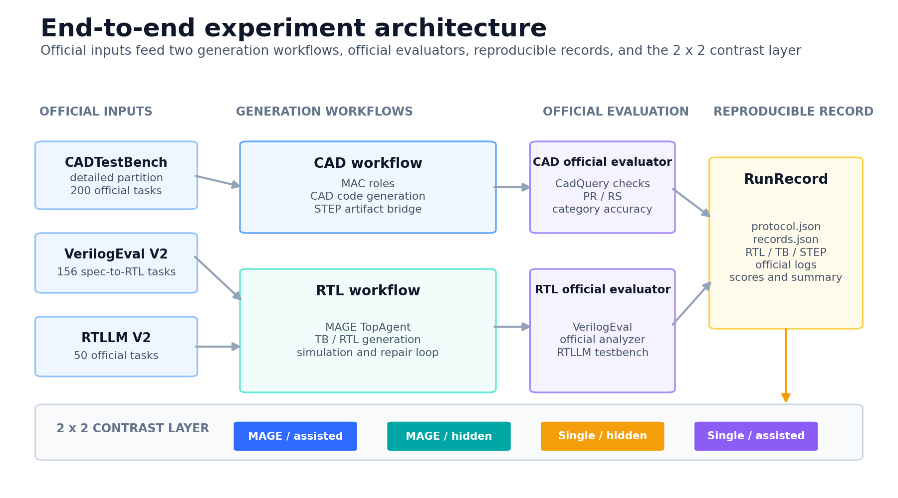
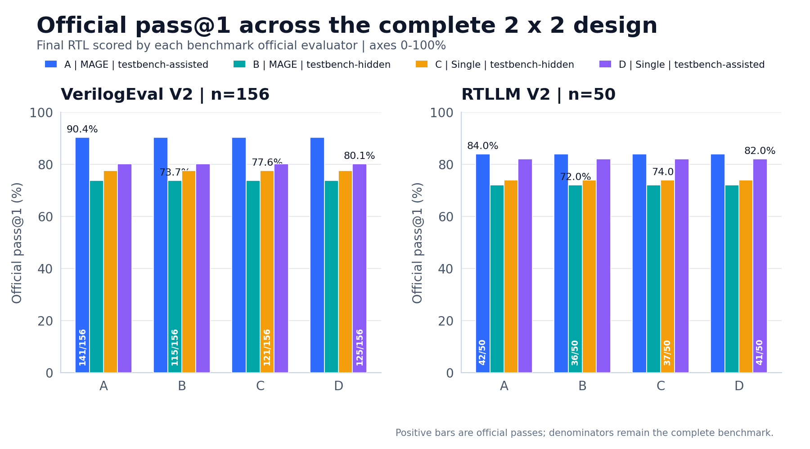
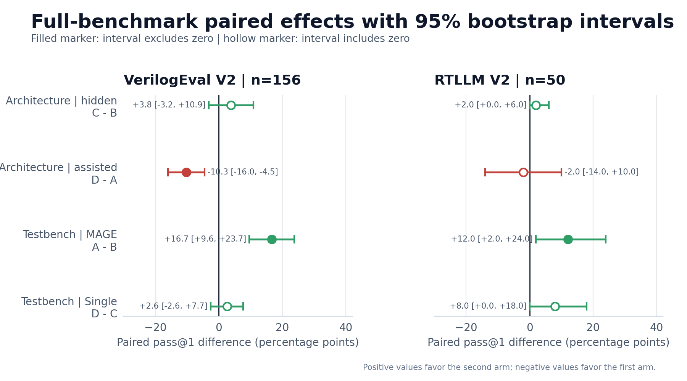

# CAD2IC 芯桥：多智能体 RTL 生成与跨基准评测


[可视化图册](docs/visualizations/index.html) ·
[最终报告](PROJECT_FINAL_REPORT.md) ·
[图表清单](docs/figures/manifest.json)

```bash
git clone https://github.com/changQiangXia/CAD2IC.git
cd CAD2IC
```

完整收尾报告：[PROJECT_FINAL_REPORT.md](PROJECT_FINAL_REPORT.md)

本目录保存 CAD 基线、MAGE 多智能体 RTL 复现、VerilogEval V2 与
RTLLM V2 的移植和实验记录。

## 目录

```text
autodl-tmp/
├── README.md
├── plan.md
├── mac_api_cadtestbench/   # CAD 基线
├── MAGE/                   # 固定 commit 的 RTL 多智能体框架
├── RTLLM/                  # RTLLM V2 固定 commit 快照
├── integration/            # provider、loader、runner、evaluator 胶水
└── runs/                   # 环境、预检、全量结果和最终材料
```

## 主结果

| 阶段 | 基准 | 样本 | 官方结果 |
|---|---|---:|---:|
| CAD | CADTestBench detailed | 200 | PR 22.0%，RS 48.0819% |
| IC 主基准 | VerilogEval V2 spec-to-RTL | 156 | pass@1 141/156，90.3846% |
| IC 迁移基准 | RTLLM V2 | 50 | pass@1 42/50，84.0% |

表格中的原始 `MAGE-assisted` RTL 实验使用 `deepseek-flash`、温度为 0.85，且
`use_golden_tb_in_mage=True`。这批结果采用**测试台辅助生成**口径，独立生成能力
需要另行设计实验。

Plan 2 进一步完成了官方 testbench 隐藏实验和单 Agent 对照：

| 组 | VerilogEval V2 | RTLLM V2 |
|---|---:|---:|
| MAGE-assisted | 141/156，90.38% | 42/50，84.0% |
| MAGE-hidden | 115/156，73.72% | 36/50，72.0% |
| Single-hidden | 121/156，77.56% | 37/50，74.0% |

当前单次全量结果暂未支持“多智能体稳定优于单 Agent”的结论；官方 testbench 可见性
带来的提升更明显。详细分析见
[Plan 2 结果](runs/plan2_results_20261110.md)。

Plan 3 补全了 D 组并加入 10 题 × 3 次重复：

| 组 | VerilogEval | RTLLM |
|---|---:|---:|
| A: MAGE-assisted | 141/156 | 42/50 |
| B: MAGE-hidden | 115/156 | 36/50 |
| C: Single-hidden | 121/156 | 37/50 |
| D: Single-assisted | 125/156 | 41/50 |

最明确的正向结果是 VerilogEval-assisted：MAGE 比单 Agent 高 10.26 个百分点，
task-level bootstrap CI `[+4.49, +16.03]`，exact McNemar `p=0.00154`。
RTLLM-assisted、hidden 设置和重复实验没有显示稳定优势。详见
[Plan 3 结果](runs/plan3_results_20261110.md)。

## 可视化图册

[打开完整 HTML 图册](docs/visualizations/index.html)，可集中浏览结构图、RTL 全量
对照、重复稳定性、置信区间、复杂子集、失败分类、修复贡献、CAD 类别结果与可旋转
CAD 模型。图册同时提供 PNG、SVG 与源数据入口。







全部图表由 `integration/plan4_visualize.py` 从冻结结果生成，资产来源与 SHA256
记录在 [manifest.json](docs/figures/manifest.json)。重新生成命令：

```bash
/root/miniconda3/envs/mac-eval/bin/python integration/plan4_visualize.py
/root/miniconda3/envs/mac-eval/bin/python -m pytest -q integration/test_plan4_visuals.py
```

当前 Plan 4 自动测试为 12 passed。

## 环境

- Ubuntu 22.04.3 LTS
- Conda 22.11.1
- `mac-gen`、`mac-eval`：Python 3.12
- `mage`：Python 3.11
- Icarus Verilog 12.0、vvp 12.0
- Verilator 5.054
- Pyverilog 1.3.0

API Key 存储在权限 `600` 的本地文件
`/root/.config/mac_api_cadtestbench/env`。源码、Notebook 与运行结果中的 Key
出现次数保持为 0。

```bash
source /root/.config/mac_api_cadtestbench/env
```

## 最小验证

```bash
cd /root/autodl-tmp/MAGE
source /root/miniconda3/etc/profile.d/conda.sh
conda activate mage
pytest -q tests/test_mage_integration.py

cd /root/autodl-tmp/integration
pytest -q test_rtllm.py
```

当前结果：MAGE 集成测试 4 passed；RTLLM 测试 4 passed。

## VerilogEval 单题

```bash
cd /root/autodl-tmp/MAGE
source /root/miniconda3/etc/profile.d/conda.sh
conda activate mage
source /root/.config/mac_api_cadtestbench/env
python /root/autodl-tmp/integration/mage_benchmark_runner.py \
  --run-dir ../runs/mage_example \
  --filter '^(Prob011_norgate)$' \
  --temperature 0.85 --top-p 0.95 --max-tokens 8192 --use-golden-tb
```

官方评测 adapter：

```bash
python /root/autodl-tmp/integration/verilog_eval_official_eval.py \
  --run-dir ../runs/mage_example \
  --output-dir ../runs/mage_example_official
```

## RTLLM 单题

```bash
cd /root/autodl-tmp/MAGE
source /root/miniconda3/etc/profile.d/conda.sh
conda activate mage
source /root/.config/mac_api_cadtestbench/env
python /root/autodl-tmp/integration/rtllm_runner.py \
  --run-dir ../runs/rtllm_example \
  --filter '^(adder_8bit)$' \
  --temperature 0.85 --top-p 0.95 --max-tokens 8192 --use-golden-tb
```

RTLLM runner 会直接调用官方 testbench 评分。4 个 Icarus 兼容性受限题自动改用
Verilator。

## CAD 全量

`mac_api_cadtestbench/MAC_API_CADTestBench.ipynb` 当前保留全量配置
`N_SAMPLES=None`。冒烟时只需改为 1，然后：

```bash
cd /root/autodl-tmp/mac_api_cadtestbench
source /root/miniconda3/etc/profile.d/conda.sh
conda activate mac-eval
source /root/.config/mac_api_cadtestbench/env
jupyter nbconvert --to notebook --execute \
  --ExecutePreprocessor.kernel_name=mac-eval \
  --ExecutePreprocessor.timeout=-1 \
  --output executed.ipynb MAC_API_CADTestBench.ipynb
```

## 材料索引

- [总体架构](docs/architecture.md)
- [Benchmark adapter](docs/benchmark_adapter.md)
- [结果与失败分析](docs/results_and_failures.md)
- [修改清单](docs/modification_manifest.md)
- [3 分钟项目介绍](docs/presentation_3min.md)
- [可视化图册](docs/visualizations/index.html)
- [图表清单](docs/figures/manifest.json)
- [Plan 2 设计](plan2.md)
- [Plan 3 设计](plan3.md)
- [Plan 4 可视化设计](plan4.md)
- [CAD 全量摘要](runs/cad_detailed_full_20261109.md)
- [VerilogEval 全量摘要](runs/mage_verilogeval_full_20261109/README.md)
- [RTLLM 全量摘要](runs/rtllm_full_20261109/README.md)

## 结论边界

- MAGE 论文中的专用训练模型数值未被复现；本实验是同一工作流接入
  DeepSeek 的运行复现。
- VerilogEval 和 RTLLM 的最终分数均来自各基准官方 testbench。
- Plan 3 已完成单 Agent 对照，结果按有条件有效口径报告。
- 测试台辅助生成结果与零样本独立生成结果分开报告。
