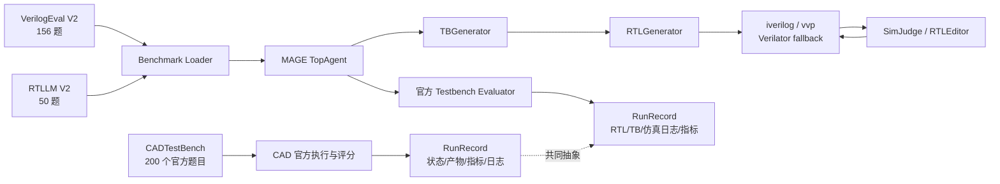
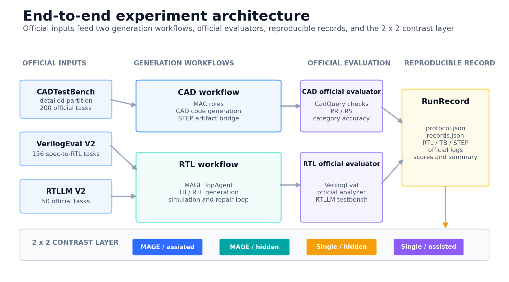

# 总体架构



稳定抽象是：

```text
Task -> Generator -> Executor -> Evaluator -> RunRecord
```

CAD 和 MAGE 各自保留原有生成流程；共享部分是实验记录与“官方测试资源判定结果”
思想。两套 Agent 分别保持原有实现，统一层仅承载实验抽象。

## 结构图资产



架构图按官方输入、生成工作流、官方评测、RunRecord 与 2×2 对照层组织。PNG 适合
报告与答辩页，SVG 保留文字编辑能力：

- [PNG](figures/project_architecture.png)
- [SVG](figures/project_architecture.svg)

## 实验链路

1. 从固定 revision 读取官方自然语言规格、testbench 和参考 RTL。
2. MAGE 使用原有的 TB 生成、RTL 生成、仿真归因和编辑修复循环。
3. Executor 捕获编译、仿真、超时和运行时错误。
4. Evaluator 直接执行基准官方 testbench。
5. RunRecord 保存任务输入哈希、模型、调用量、token、耗时、产物和分数。

## 日志与复现

每个全量 run 目录保留：

- `protocol.json`
- `records.json`
- `summary.json`
- 每任务详细日志
- 最终 RTL、TB 和中间接口
- 官方评分日志
- 预检与 adapter 复算记录
