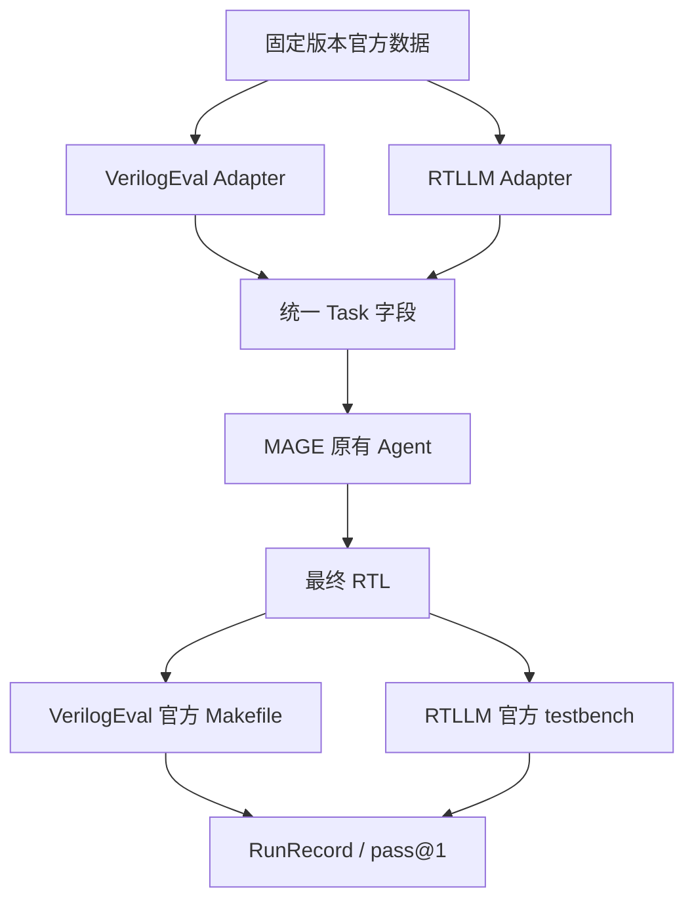
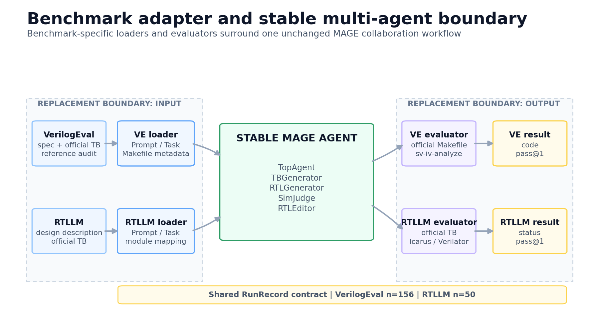

# Benchmark Adapter

图中输入边界包含官方数据、benchmark loader 与统一 Task 字段；输出边界包含
benchmark 专属 evaluator 与官方结果。中间 MAGE 多角色协作关系保持原样。

- [PNG](figures/benchmark_adapter.png)
- [SVG](figures/benchmark_adapter.svg)

## 稳定部分

- MAGE 的 `TopAgent`、`TBGenerator`、`RTLGenerator`、`SimJudge`、
  `RTLEditor` 协作关系；
- 自然语言规格、RTL、testbench、仿真日志的数据形态；
- 候选生成、修复次数和官方 testbench 分离。

## 更换内容

| 层 | VerilogEval V2 | RTLLM V2 |
|---|---|---|
| task_id | `ProbXXX_*` | 设计目录名 |
| 官方规格 | `*_prompt.txt` | `design_description.txt` |
| testbench | `*_test.sv` | `testbench.v` |
| 参考 RTL | `*_ref.sv` | `verified_*.v` |
| 最终 evaluator | 官方 Makefile / `sv-iv-analyze` | 官方 `testbench.v` 输出 |
| 特殊处理 | 无 | 4 题 Verilator fallback |

RTLLM adapter 还会把参考 RTL 的 `verified_` 主模块名机械替换为官方 testbench
实例化名称。该操作仅调整模块名，内部逻辑保持原样。

## 为什么没有改 Agent

两个基准的输入均为自然语言规格与 RTL testbench，执行器均为 Verilog
编译/仿真，输出均为 RTL 与仿真日志。差异只存在于文件组织、模块命名和官方判分入口，
因此可在 benchmark 层吸收。
