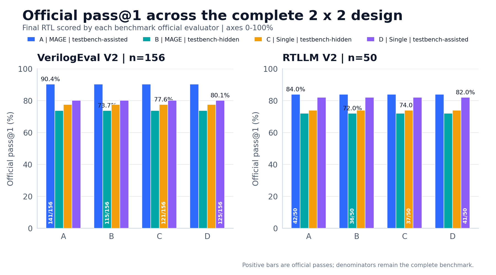
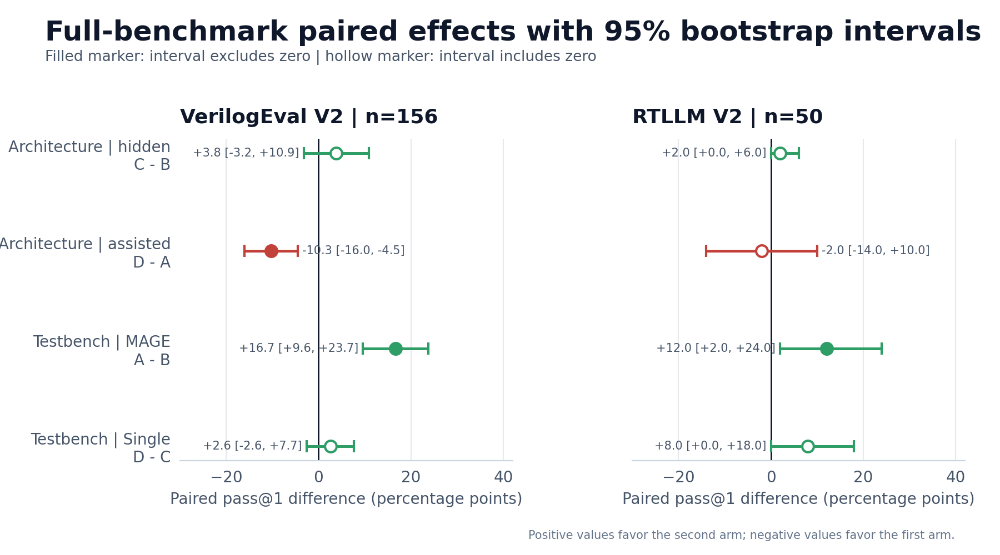
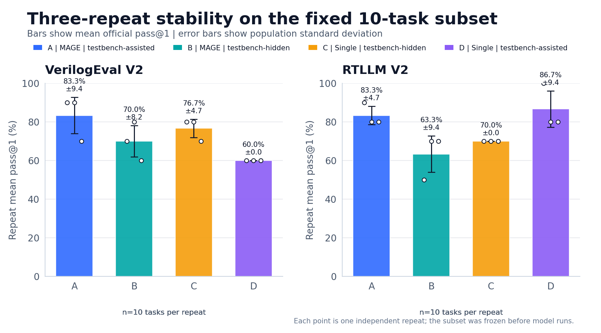
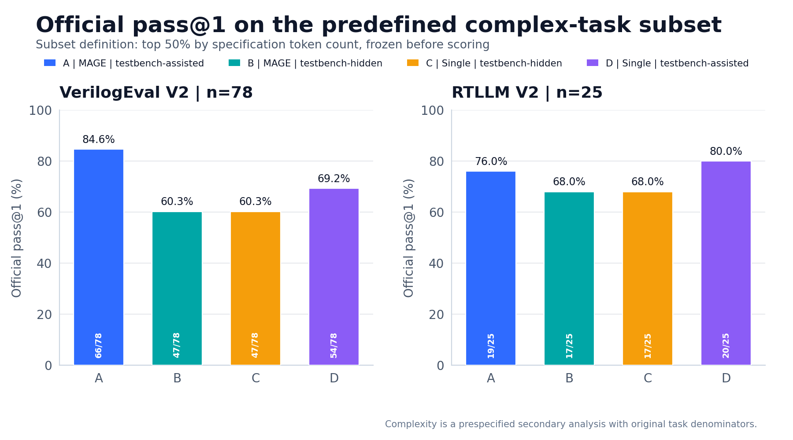
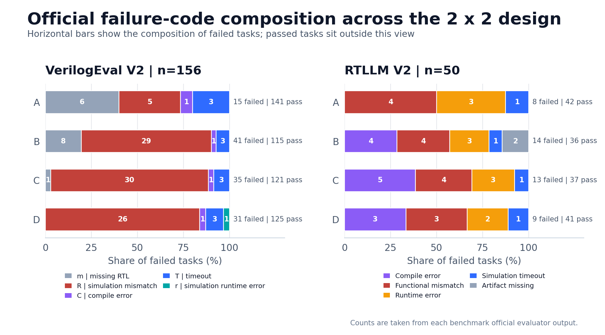
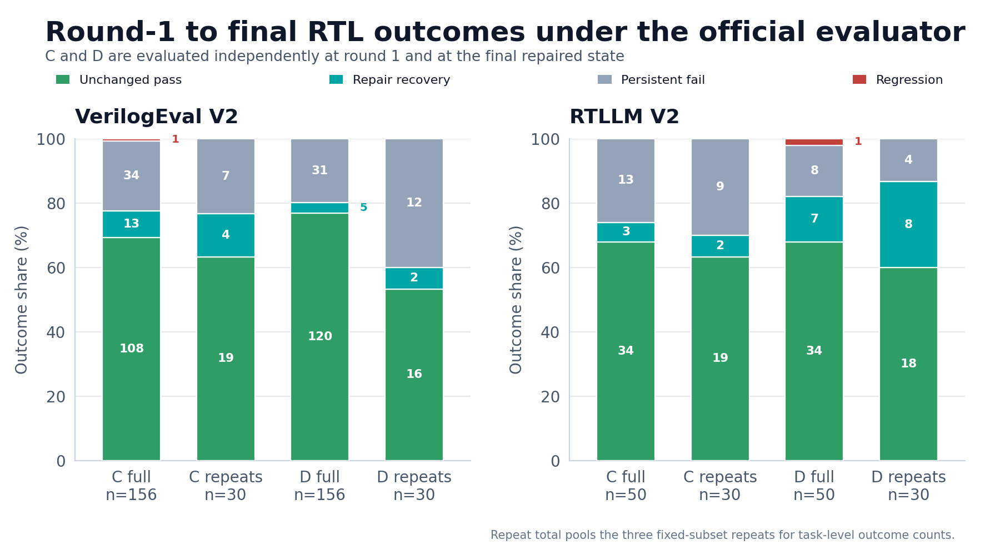

# 结果与失败分析

## 汇总

| 基准 | 官方通过 | 分母 | 指标 |
|---|---:|---:|---:|
| CADTestBench detailed | 44 | 200 | PR 22.0% |
| VerilogEval V2 | 141 | 156 | pass@1 90.3846% |
| RTLLM V2 | 42 | 50 | pass@1 84.0% |

CAD 的 RS 为 48.0819%，无效样本为 34.0%。

## 可视化总览

[可视化图册](visualizations/index.html)集中组织全部图表、源数据链接与 CAD 交互资产。
图表数值直接从冻结 JSON、CSV 与正式 evaluator 结果生成，训练条件、题目集和官方
评分口径保持原样。

上图展示完整 2×2 设计。柱内数字为官方通过数与完整分母，柱顶为 pass@1。四组颜色在
全部 RTL 图中保持一致。

森林图的零线对应两组结果相同。正效应表示 second arm 更高，负效应表示 first arm
更高；实心点对应区间离开零线，空心点对应区间包含零线。VerilogEval-assisted 的
A−B 效应为 +16.67 个百分点，区间 `[+9.62,+23.72]`，是当前最明确的正向结果。

重复图同时保留均值、总体标准差与三次独立运行点。固定子集用于观察远程模型波动，
结论范围限于这 10 道预设题目。

复杂任务集合在正式评分前按规格 token 数冻结，VerilogEval 包含 78 题，RTLLM 包含
25 题。四组使用统一题集。

失败图按官方 code 与 RTLLM 仿真状态分类。横向柱的百分比以各 arm 失败任务数为母数，
柱末同时给出失败数与通过数。

修复图将同一官方 evaluator 的 round-1 与最终结果配对，拆分为稳定通过、修复恢复、
持续失败与回归。完整数据见
[summary.json](../runs/plan3_repair_analysis_20261110/summary.json)。

CAD 可视化包含官方 PR、RS、无效样本比例与六类检查准确率，并索引正式 run 的实体
图册和可旋转模型：

- [CAD 官方指标](figures/cad_official_metrics.png)
- [CAD 类别准确率](figures/cad_category_accuracy.png)
- [完整图册](visualizations/index.html)
- [图表清单](figures/manifest.json)

## Plan 2 隐藏 Testbench 与单 Agent 对照

| 基准 | MAGE-assisted | MAGE-hidden | Single-hidden |
|---|---:|---:|---:|
| VerilogEval V2 | 141/156，90.38% | 115/156，73.72% | 121/156，77.56% |
| RTLLM V2 | 42/50，84.0% | 36/50，72.0% | 37/50，74.0% |

隐藏官方 testbench 后，VerilogEval 的 A-B 差值为 +16.67 个百分点，
95% bootstrap CI 为 +9.62 到 +23.72 个百分点；RTLLM 的 A-B 差值为
+12 个百分点，CI 为 +2 到 +24 个百分点。

B vs C 的单 Agent 减 MAGE 差值：VerilogEval +3.85 个百分点，CI
`[-3.21, +10.90]`；RTLLM +2 个百分点，CI `[0, +6]`。因此当前数据暂未支持
“多智能体更优”的统计结论。

该 CI 的覆盖范围限于 task bootstrap；A 与 B 属于独立运行，采集时间各异。
以上是单次全量的描述性证据，若需因果或显著性结论，应进行 3 次重复运行。

## Plan 3 完整 2×2 与重复验证

| 基准 | MAGE-assisted | MAGE-hidden | Single-hidden | Single-assisted |
|---|---:|---:|---:|---:|
| VerilogEval V2 | 141/156 | 115/156 | 121/156 | 125/156 |
| RTLLM V2 | 42/50 | 36/50 | 37/50 | 41/50 |

VerilogEval-assisted 上，MAGE 比 Single-agent 高 10.26 个百分点，
95% bootstrap CI `[+4.49, +16.03]`，exact McNemar `p=0.00154`。
RTLLM-assisted 上 MAGE 仅高 1 题，hidden 设置下单 Agent 略高，两组差异稳定性有限。

10 题 × 3 次重复中，VerilogEval 的 A/D 均值分别为 8.33 和 6.00；
RTLLM 的 A/D 均值为 8.33 和 8.67。模型波动与任务间差异说明单次点估计仅适合
描述当前实验。

官方评分下的修复分析表明，单 Agent 修复在 VerilogEval 把 13 个 round-1 失败
转为通过，但也出现 1 个回归；RTLLM 的 assisted 单 Agent 把 7 个失败转为通过。

最终边界：MAGE 的正向证据主要出现在 VerilogEval 的 testbench-assisted 设置，
适用范围限于本次基准、模型、预算与运行条件。

## VerilogEval V2

- MAGE 内置 golden-sim：143/156
- VerilogEval 官方 `sv-iv-analyze`：141/156
- 官方结果码：
  - `.`：141
  - `m`：6
  - `R`：5
  - `C`：1
  - `T`：3
- 6 题没有非空 RTL。
- 13 题官方 testbench 未通过。
- 3 题官方 `T` 的日志显示 mismatch 为 0，但日志包含测试台正常结束前的
  `TIMEOUT` 文本，官方 analyzer 按 `T` 处理。
- `Prob078_dualedge` 存在逐输出 mismatch，但官方 analyzer 依据末行
  `Mismatches: 0` 判通过。

因此正式分数使用官方 141/156；143/156 仅保留为内置判分的审计数据。

## RTLLM V2

类别结果：

| 类别 | 通过/总数 | 通过率 |
|---|---:|---:|
| Arithmetic | 18/19 | 94.74% |
| Control | 6/6 | 100% |
| Memory | 3/5 | 60% |
| Miscellaneous | 15/20 | 75% |

失败分类：

- 功能 mismatch：4
  - `float_multi`
  - `barrel_shifter`
  - `freq_divbyfrac`
  - `freq_divbyodd`
- 官方 testbench 输出 Error：3
  - `asyn_fifo`
  - `alu`
  - `signal_generator`
- 仿真超时：1
  - `serial2parallel`
- RTL 缺失：0
- 编译错误：0

MAGE 内置判分 38/50，官方 testbench 42/50。6 题发生判分差异，说明最终成绩必须
使用官方 testbench。

## 环境与基础设施

- API 调用过程中的 HTTP 200 返回正常。
- 两个全量 RTL 实验均完成全部样本。
- 无 API Key 泄漏。
- VerilogEval 官方 adapter 可重复得到 141/156。
- RTLLM 参考 RTL 最终 50/50 通过。
- RTLLM 的 4 个 Icarus 兼容性受限题使用 Verilator：`asyn_fifo`、
  `ring_counter`、`radix2_div`、`clkgenerator`。

## 可解释性限制

- 模型为远程 DeepSeek；结果受远程输出波动影响。
- `use_golden_tb_in_mage=True`，该结果与独立生成结果分开报告。
- 官方 analyzer 的启发式结果码是基准实现的一部分，本工作未修改其规则。
- RTLLM 的 Verilator fallback 属于 Icarus 兼容性工具替换，官方
  testbench 或成功文本。
